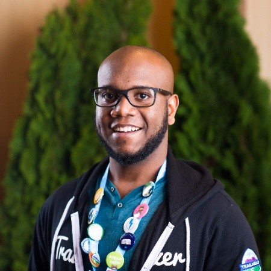

<p align="center">
  <a href="https://revenueeng.com">
    
  </a>
</p>

<h1 align="center">ai-coding</h1>

<p align="center">
  Reusable skills and tools for AI-assisted coding.
</p>

<p align="center">
  <a href="https://revenueeng.com"><b>Newsletter</b></a> &nbsp;·&nbsp;
  <a href="https://www.youtube.com/@Walters954"><b>YouTube</b></a>
</p>

---

I'm Warren. I write everything in Claude Code, usually with several work streams going at once in
separate worktrees. That's great for throughput and terrible for attention: by the third parallel
stream you are skimming diffs instead of reading them. These are the guardrails I built so that
stops being a problem.

Everything here is small, editable, and meant to be forked. Take what's useful, change what
isn't, delete the rest.

I break down how I use these on [YouTube](https://www.youtube.com/@Walters954), and write up the
ones that earn their keep in [the newsletter](https://revenueeng.com).

## Skills

| Skill | What it does |
| --- | --- |
| [`codex-code-review`](skills/codex-code-review/SKILL.md) | Runs the OpenAI Codex CLI as an independent, read-only second-opinion review of a diff before it becomes a PR, then triages the findings instead of applying them blindly. |
| [`diff-explainer`](skills/diff-explainer/README.md) | Turns an agreed diff into an offline HTML explanation and quiz. Includes an [invented example](skills/diff-explainer/example.html). |
| [`focused-cleanup`](skills/focused-cleanup/README.md) | Improves a small, agreed diff while preserving behavior and documenting tradeoffs. |
| [`worktree-bootstrap`](skills/worktree-bootstrap/README.md) | Plans setup first; named environment links and dependency installation each require explicit opt-in. |

## GitHub utilities

| Tool | What it does |
| --- | --- |
| [`pr_status.py`](tools/github-status/PR_STATUS.md) | Reads all review, thread, and check pages for a PR's current commit; unresolved threads block a successful report. |
| [`queue_snapshot.py`](tools/github-status/QUEUE_SNAPSHOT.md) | Discovers the default branch and requires two matching snapshots of the open PR queue. |

Both use Python's standard library and the authenticated GitHub CLI. Reports describe observed signals; they never authorize a merge. [Offline tests and synthetic output](tools/github-status/README.md#offline-tests-and-example-output) are included.

## Projects & Demos

| Project | What it does | Tech Stack |
| --- | --- | --- |
| [`jev-account-dedupe`](projects/jev-account-dedupe) | CRM Account Deduplication using Jev System One evaluation model on Vercel AI Gateway & TypeSafe AI. Evaluates duplicates with zero generation tokens, ~50–100ms latency, collapsible presentation panels, and live cost comparison vs traditional LLMs. | Next.js 16, TypeScript, TypeSafe AI SDK, Vercel AI SDK, Tailwind CSS |

See the [skills guide](skills/README.md) for requirements and usage.

## Quick start for agents

These skill directories are generic rewrites of coding workflows, with names chosen for the reusable versions. Each has a README with requirements, installation, an example prompt, expected results and troubleshooting. From an agent session in this checkout, you can invoke one directly without installing it:

> Read skills/diff-explainer/SKILL.md. Explain the committed changes on this branch against its merge base with the default branch. Exclude staged, unstaged and untracked work. Save the offline result to /tmp/change-explained.html; do not open or publish it.

For cleanup, point the agent at `skills/focused-cleanup/SKILL.md` and name the exact diff. For setup, point it at `skills/worktree-bootstrap/SKILL.md` and request a plan first. When installed in another project, name the skill or provide its installed `SKILL.md` path; discovery and invocation syntax depend on the agent.

Try both GitHub helpers without authentication or network calls:

```sh
python3 tools/github-status/tests/example_output.py
```

For real reads, follow the [authentication and permission guide](tools/github-status/README.md#authentication-and-permission-scope), then use the tool's README commands. Real reports from private repositories should stay private.

## Install

Copy a skill directory into your project's `.claude/skills/`:

```bash
git clone https://github.com/walters954/ai-coding.git
cp -R ai-coding/skills/codex-code-review /path/to/your-project/.claude/skills/
```

Or make it available in every project by linking it into your user scope:

```bash
mkdir -p ~/.claude/skills
ln -s "$(pwd)/ai-coding/skills/codex-code-review" ~/.claude/skills/codex-code-review
```

Claude Code follows symlinks for skill discovery, so linking beats copying. One source of truth,
nothing to re-sync when you edit a skill.

A skill's invocable name is its **directory name**, not the `name:` in the frontmatter.

## Why a second model reviews the code

The review skill exists because of one specific failure mode. A model that wrote the code is not
a neutral reviewer of it. It knows what it meant, so it reads its own intent back into the diff.

The highest-value thing you can ask an outside reviewer: **are my invariants actually enforced,
or only intended?**

That question caught a real one for me. A branch had a "never deploy to production" rule that
was genuinely in the design and genuinely in the instructions, and nowhere in the code. A
misconfigured connector would have sailed straight through. The rule existed in my head. The
review is what moved it into the codebase.

Treat any review output as claims to verify, never as truth to apply. These models are just as
confident when they're wrong.

## License

MIT. See [LICENSE](LICENSE).
